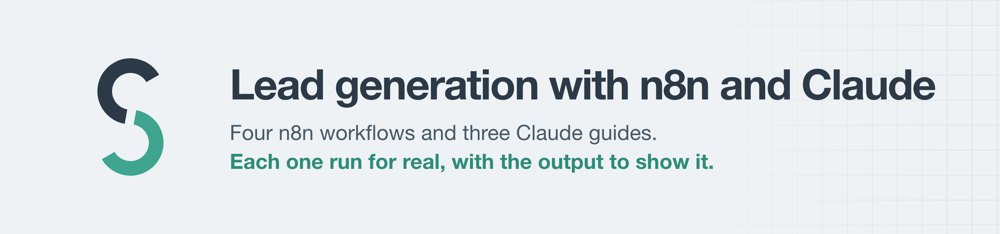
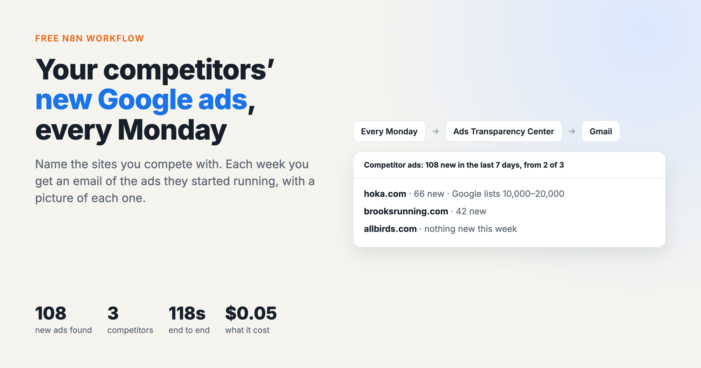
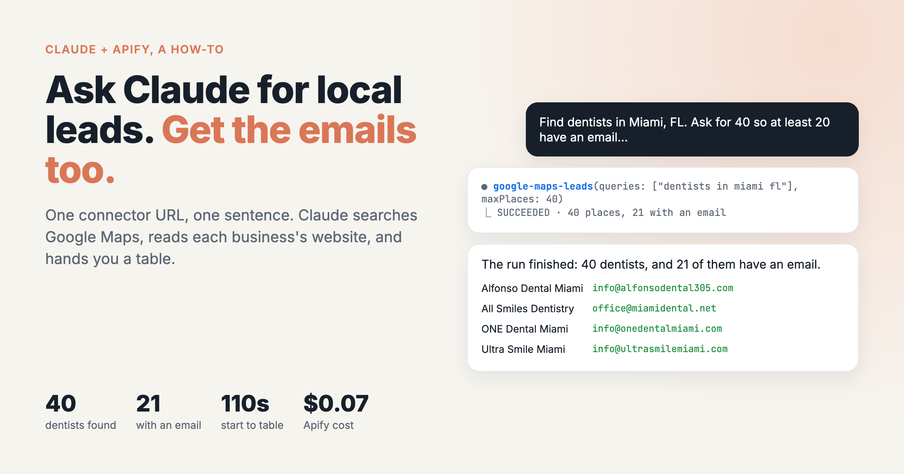

<picture><source media="(prefers-color-scheme: dark)" srcset="images/header-dark.png"></picture>

*I wrote this with an AI assistant. The runs, numbers and code are real, and I checked them.*

I build web scrapers and publish them on Apify. Most people who need business leads don't
want a scraper, though. They want a Google Sheet that fills itself, a Slack message
when something changes, or to ask Claude and get a table back. So here are both: ready
n8n workflows you import in a minute, and guides to doing the same jobs from Claude.

Every workflow and every guide was run against the live scrapers on 24 Oct 2026. The
pictures are that real output. Each page also says what wasn't tested and what went
wrong.

## n8n workflows

<p>
<a href="n8n/google-maps-leads-to-sheets/README.md"></a>
<a href="n8n/competitor-ads-weekly-digest/README.md"></a>
<a href="n8n/linkedin-jobs-to-slack/README.md"></a>
<a href="n8n/crm-sheet-contact-enrichment/README.md"></a>
</p>

| Workflow | What you get | In the test run |
|---|---|---|
| [Google Maps leads → Google Sheets](n8n/google-maps-leads-to-sheets/README.md) | Every business for a Maps search, with the emails, phones and socials its website publishes, one row each | 10 Miami dentists, 8 with an email, 33 s |
| [Weekly competitor-ads email](n8n/competitor-ads-weekly-digest/README.md) | Every Monday, the Google ads your competitors started that week, with pictures | 108 new ads across 3 brands, 118 s |
| [LinkedIn jobs → Slack](n8n/linkedin-jobs-to-slack/README.md) | New public job postings for your keywords and places, twice a day, each one once | 25 Austin jobs, 0 repeats on the second run |
| [Fill in emails for a company sheet](n8n/crm-sheet-contact-enrichment/README.md) | Email, phone and socials written into the rows of your sheet that have a website and no email | 4 of 4 sites gave an email, 20 s |

**To use one:** download its `workflow.json`, then in n8n open a new workflow and use
**⋯ → Import from File**. They use Apify's n8n node, which n8n has verified. On n8n
Cloud, search "Apify" in the node panel. Self-hosted: **Settings → Community Nodes →
`@apify/n8n-nodes-apify`**. Each workflow keeps everything you'd edit in one node near
the start, and each has notes on the canvas.

## Claude guides

<p>
<a href="claude/google-maps-leads/README.md"></a>
<a href="claude/website-contacts/README.md"></a>
<a href="claude/competitor-ads/README.md"></a>
</p>

| Guide | The prompt, in short | In the test run |
|---|---|---|
| [Local business leads with emails](claude/google-maps-leads/README.md) | "Find dentists in Miami, FL. Ask for 40 so at least 20 have an email…" | 40 found, 21 with an email, 110 s, $0.07 |
| [Emails for a list of websites](claude/website-contacts/README.md) | "Here are six company websites. Find the best email and phone for each…" | 4 emails, 1 site with none, 1 dead domain, 54 s, $0.02 |
| [Competitors' new Google ads](claude/competitor-ads/README.md) | "Compare the Google ads these three sites started in the last 30 days…" | 399 new ads, 4 min, $0.20, or $5.58 if you word it differently |

All three use one connector. Add this URL in Claude (Customize → Connectors → Add
custom connector, then sign in to Apify), or in Claude Code with `claude mcp add
--transport http lead-tools "<url>"`:

```
https://mcp.apify.com/?tools=simple.actor/google-maps-leads,simple.actor/website-contacts,simple.actor/google-ads-transparency,simple.actor/linkedin-jobs
```

It gives Claude these four scrapers and nothing else. That matters, because otherwise it
picks a scraper on its own.

## The scrapers behind them

| Scraper | Price on 24 Oct 2026 |
|---|---|
| [Google Maps Leads](https://apify.com/simple.actor/google-maps-leads) | $0.50 per 1,000 businesses + $1.50 per 1,000 that gave contacts |
| [Website Contacts](https://apify.com/simple.actor/website-contacts) | $0.001 a run + $0.75 per 1,000 pages read |
| [Google Ads Transparency](https://apify.com/simple.actor/google-ads-transparency) | $0.50 per 1,000 ads |
| [LinkedIn Jobs](https://apify.com/simple.actor/linkedin-jobs) | $0.30 per 1,000 jobs + $0.00005 a run |

You pay through your own Apify account. A free account comes with $5 of usage a month
and no card. Prices can change, and each listing shows the current one.

More scrapers and write-ups: [github.com/simple-actor](https://github.com/simple-actor) ·
[simple-actor.github.io](https://simple-actor.github.io)

*Unofficial. Not affiliated with, endorsed by or sponsored by Google, LinkedIn, n8n,
Anthropic or Apify.*
