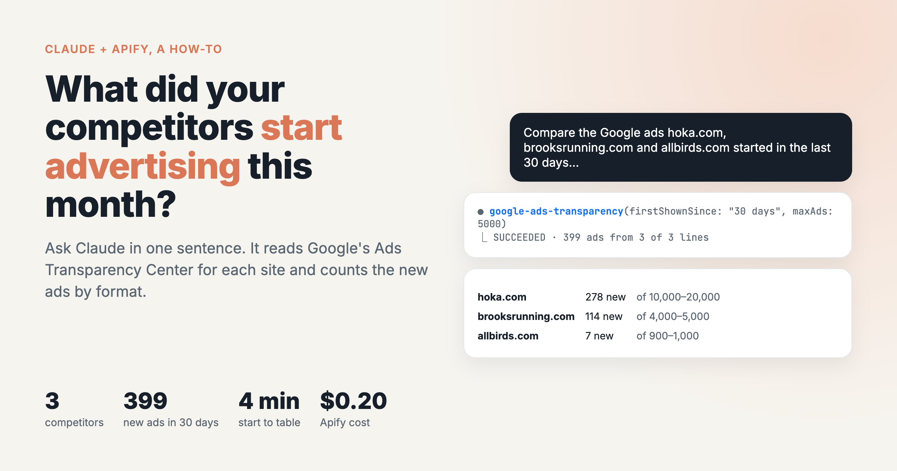
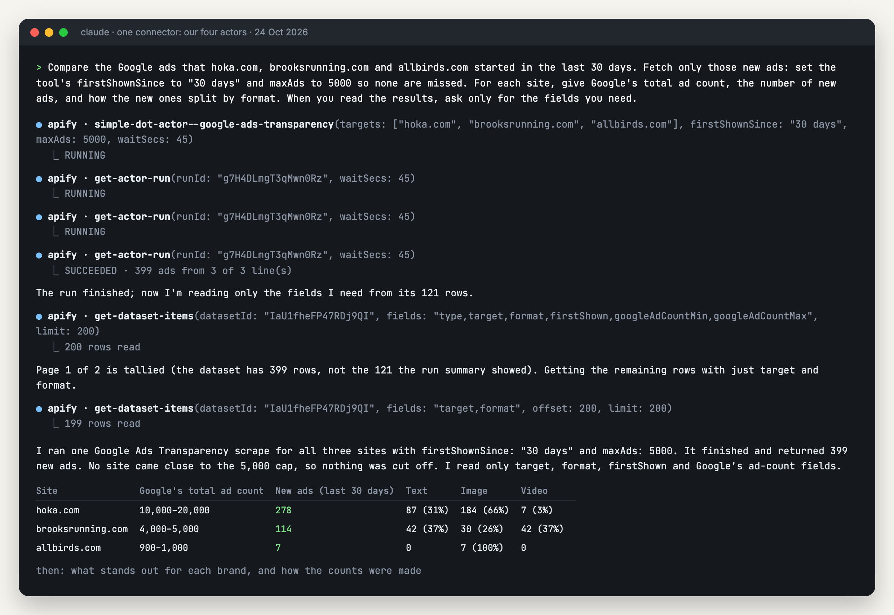
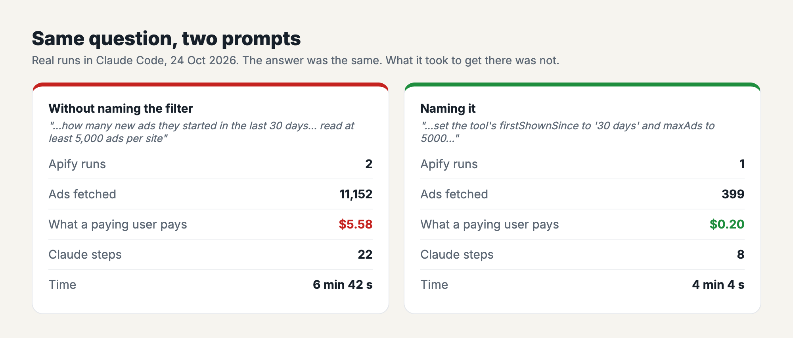

# Ask Claude what your competitors started advertising on Google

*I wrote this with an AI assistant. The runs, numbers and code are real, and I checked them.*



Google publishes every ad an advertiser runs in its Ads Transparency Center, but it
shows them one advertiser at a time, a page of thumbnails at a time. I built [a scraper](https://apify.com/simple.actor/google-ads-transparency)
that reads it in bulk, and you can run it from Claude. You ask which ads three running-shoe
brands started in the last 30 days, and you get counts, formats and dates back in a table.

This guide has a warning in it that the others don't. My first prompt got the right
answer for **28 times** the cost of the second, and the difference was one phrase.

## Setup

Same connector as the other guides. If you have it, skip ahead. If not, add this URL
as a custom connector (claude.ai or desktop: Customize → Connectors → + Add → Add custom
connector, then sign in to Apify; Claude Code: `claude mcp add --transport http
lead-tools "<url>"` then `/mcp`):

```
https://mcp.apify.com/?tools=simple.actor/google-maps-leads,simple.actor/website-contacts,simple.actor/google-ads-transparency,simple.actor/linkedin-jobs
```

You need Claude (any plan) and an Apify account (free, $5 of usage a month).

## The prompt

```
Compare the Google ads that hoka.com, brooksrunning.com and allbirds.com started in the last 30 days. Fetch only those new ads: set the tool's firstShownSince to "30 days" and maxAds to 5000 so none are missed. For each site, give Google's total ad count, the number of new ads, and how the new ones split by format. When you read the results, ask only for the fields you need.
```

Websites work better than brand names: a website catches every advertiser running ads
for that site, including the brand's regional companies and its agencies. Put in your
own competitors.

## What happened



One Apify run for all three sites (170 seconds), then Claude read the results in two
pages. It noticed that the run summary said 121 rows when the dataset held 399, and
counted from the dataset. Run summaries can lag behind the data, and it handled that
well.

| Site | Google's total ad count | New ads (last 30 days) | Text | Image | Video |
|---|---|---|---|---|---|
| hoka.com | 10,000–20,000 | **278** | 87 (31%) | 184 (66%) | 7 (3%) |
| brooksrunning.com | 4,000–5,000 | **114** | 42 (37%) | 30 (26%) | 42 (37%) |
| allbirds.com | 900–1,000 | **7** | 0 | 7 (100%) | 0 |

I recounted all 399 rows myself, and every number in that table is right. Google only
states its totals as ranges, so those stay ranges.

Claude also pointed out that Brooks launched most of its 42 new videos within about two
minutes on Oct 1. That's true: they're stamped between 19:45 and 19:47.

## The phrase that cost $5.38



My first attempt asked the same question in plainer words: "how many new ads they
started in the last 30 days… read deep, at least 5,000 ads per site". Claude didn't use
the tool's first-shown filter. It read and returned **every** ad up to 5,000 per site,
10,751 of them, and only then ran a second, filtered pass to count the new ones. Same
answer in the end, give or take one ad per site at the window's edge. But the tool
charges $0.0005 per ad returned, so for a paying user the first pass alone was $5.38.

So name the filter in the prompt. "Set the tool's firstShownSince to '30 days'" is
enough. It also took Claude 8 steps instead of 22.

## Why "maxAds to 5000"

Google lists an advertiser's ads by when they were **last shown**, newest first, and
the scraper reads that list from the top. `maxAds` caps how many ads come back, and it
also caps how far down the list the scraper reads. A big advertiser has thousands of
long-running ads that were all shown today, and they sit above the new ones. Read too
shallow and you miss new ads. In a test the same day, I counted hoka.com's new ads from
the last 7 days at three depths: 5 at the default of 100, 53 at 1,000, and 66 at 5,000.

Claude's explanation of why nothing was missed ("no site came close to the 5,000 cap")
had the right conclusion for a slightly wrong reason. The real check: in my first run,
the 5,000th hoka.com ad was last shown on Sep 20. That's before the window opened, so
nothing further down could be new. For a brand with tens of thousands of ads running
every day, raise `maxAds` again. You only pay for the ads that come back.

## What to check in the commentary

The counts were right both times. The colour around them was not always:

- In the recommended run, Claude said hoka.com had "a big burst on Oct 19 and another on
  Oct 15". The real spikes were Oct 1 (76 new ads) and Oct 19 (56). Oct 15 was the date
  of Allbirds' last ad, so it looks like the two got mixed up.
- In the first run, Claude said hoka.com's text ads "came mostly from resellers". 54 of
  the 88 came from Deckers Outdoor Corporation, which owns Hoka.

If an observation matters to you, ask a follow-up like "show me the new ads per day for
hoka.com", and Claude will count it from the rows.

## What it can't do here

Claude gets counts, formats, dates, advertiser names and a link to each ad. It doesn't
see the pictures through this route. To look at the ads themselves, ask for the links
(each one opens the ad in Google's Transparency Center), or use the [weekly email
workflow I built for n8n](../../n8n/competitor-ads-weekly-digest/README.md), which puts the pictures in your inbox.

## What it costs

$0.0005 per ad returned. 399 new ads cost $0.20. A competitor with nothing new costs
nothing. Claude's own usage comes out of your Claude plan.
