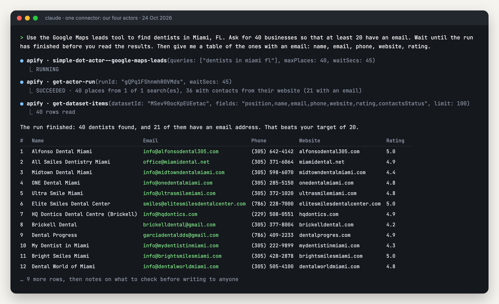
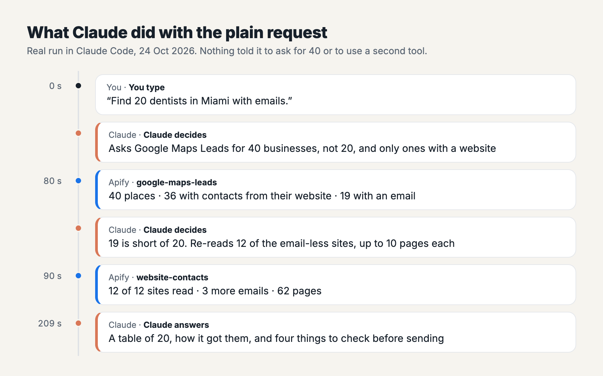

# Get local business leads with emails in Claude

*I wrote this with an AI assistant. The runs, numbers and code are real, and I checked them.*


I built [a Google Maps scraper](https://apify.com/simple.actor/google-maps-leads) that also reads each business's own website for emails,
phones and social accounts. You can call it from Claude: type "find dentists in
Miami, FL" and get a table back. This is how to set that up, the prompt that worked
best, and what happened when I ran it. That includes the parts to check before you
email anyone.

The setup takes about five minutes. My run found 40 Miami dentists, 21 of them with an
email, in 110 seconds, for about $0.07 of Apify usage.

## What you need

- **Claude**, on claude.ai, the desktop app or Claude Code. Any plan works. The free plan
  allows one custom connector, and this setup uses one.
- **An Apify account.** The free plan comes with $5 of usage a month and no card.
  That's enough for dozens of searches like this one.

## Step 1: add the connector

Apify runs an MCP server, the thing that lets Claude use outside tools. You point
Claude at a URL, and the URL decides which tools Claude gets. This one gives it four of
my actors and nothing else:

```
https://mcp.apify.com/?tools=simple.actor/google-maps-leads,simple.actor/website-contacts,simple.actor/google-ads-transparency,simple.actor/linkedin-jobs
```

Why not the plain `https://mcp.apify.com`? That version lets Claude search the whole
Apify Store and pick a scraper on its own. With the URL above it gets Google Maps Leads,
Website Contacts, Google Ads Transparency and LinkedIn Jobs, plus a few helpers to read
results.

**claude.ai or the desktop app.** Go to Customize → Connectors → **+ Add** → **Add custom
connector**. Give it a name ("Lead tools"), paste the URL, and click Add. Claude
opens an Apify sign-in, you approve, and it's done. Connectors are set once per account,
so the desktop app and the website share it. In a chat, switch it on from the **+** menu
under Connectors.

**Claude Code.** One command:

```bash
claude mcp add --transport http lead-tools "https://mcp.apify.com/?tools=simple.actor/google-maps-leads,simple.actor/website-contacts,simple.actor/google-ads-transparency,simple.actor/linkedin-jobs"
```

Then run `/mcp` inside Claude Code and sign in to Apify. If you'd rather use a token,
add `--header "Authorization: Bearer YOUR_APIFY_TOKEN"` to the command. The token is in
Apify Console under Settings → API & Integrations. That's how I ran the test below.

## Step 2: ask for more than you need

This is the prompt I'd use:

```
Use the Google Maps leads tool to find dentists in Miami, FL. Ask for 40 businesses so that at least 20 have an email. Wait until the run has finished before you read the results. Then give me a table of the ones with an email: name, email, phone, website, rating.
```

Each sentence is there for a reason:

- **"40 so that at least 20 have an email."** Google Maps lists businesses. Whether a
  business puts an email on its website is up to them. In my runs it was about half.
  Ask for twice what you want.
- **"Wait until the run has finished."** A 40-business search takes about 80 seconds,
  and Claude checks on it in steps. If it reads the results before the run ends, it gets
  a partial list that looks complete. When I tested the tools directly, an early read
  returned 10 rows out of an eventual 20, with no hint that more were coming. Claude
  waited properly in both of my runs. This sentence keeps it that way.
- **"Put the place in the search."** "Dentists in Miami, FL", not "dentists". A search
  with no place gets answered for wherever Google thinks the request came from, which is
  a data centre.

## What happened



Three tool calls. Claude started the search and asked for 40. It polled until the run
finished (83 seconds), then read only the columns it needed. Its answer:

> The run finished: 40 dentists found, and 21 of them have an email address. That beats your target of 20.

| # | Name | Email | Phone | Website | Rating |
|---|---|---|---|---|---|
| 1 | Alfonso Dental Miami | info@alfonsodental305.com | (305) 642-4142 | alfonsodental305.com | 5.0 |
| 2 | All Smiles Dentistry Miami | office@miamidental.net | (305) 371-6064 | miamidental.net | 4.9 |
| 3 | Midtown Dental Miami | info@midtowndentalmiami.com | (305) 598-6070 | midtowndentalmiami.com | 4.4 |
| 4 | ONE Dental Miami | info@onedentalmiami.com | (305) 285-5150 | onedentalmiami.com | 4.8 |
| 5 | Ultra Smile Miami | info@ultrasmilemiami.com | (305) 372-1020 | ultrasmilemiami.com | 4.8 |
| 6 | Elite Smiles Dental Center | smiles@elitesmilesdentalcenter.com | (786) 228-7000 | elitesmilesdentalcenter.com | 5.0 |
| 7 | HQ Dontics Dental Centre (Brickell) | info@hqdontics.com | (229) 508-0551 | hqdontics.com | 4.9 |
| 8 | Brickell Dental | brickelldental@gmail.com | (305) 377-8004 | brickelldental.com | 4.2 |

…and 13 more. I checked all 21 against the raw data afterwards, and every email, phone,
website and rating matched.

Claude also flagged things I'd want flagged. Three practices publish an email on a
different domain from their website. One listing's phone has a Georgia area code for a
Brickell office (that number is on the Google listing, not something Claude made up).
And it accounted for the other 19 without an email: 15 sites gave a phone or social
accounts but no email, 3 sites showed a bot check instead of the page, and 1 published
nothing.

## What happens if you just say "find 20 dentists in Miami with emails"

I tried that too, in a fresh session. It works, but it takes longer and costs more:



Nobody told Claude to ask for 40, and it did anyway. It also limited the search to
businesses with a website. That run found 19 emails, one short. So Claude took the 12
email-less sites and sent them to the second tool, Website Contacts, with a deeper read
(up to 10 pages a site against 4). That found 3 more, and it answered with exactly 20.
Along the way it dropped a practice for being in South Miami rather than Miami, which is
correct: South Miami is its own city.

It also got one thing wrong. It said two Ultra Smile branches "use the same address".
They share an *email*; the addresses are different. A small thing, but it's the kind of
detail to check yourself before it ends up in a CRM.

That run took 209 seconds instead of 110, and the second tool added about $0.05.

## What it costs

On Apify, Google Maps Leads costs $0.0005 per business returned, plus $0.0015 for each
business whose website gave any contact details. My 40-dentist search came to $0.074,
and the plain-prompt run with its second pass came to about $0.12. Businesses whose
website gave nothing aren't charged the second part. Claude's own usage comes out of
your Claude plan as usual.

## Two runs, two different answers

My two runs started a second apart, and one found 19 emails while the other found 21.
Part of that is the plain run leaving out businesses with no website, which changed 2 of
the 40. The rest is websites themselves: of the 38 businesses both runs found, Dental
World of Miami gave its email on one visit and not on the other. Sites answer slowly or
show a bot check some of the time. If a business you expected comes back without an
email, ask Claude to run Website Contacts on just that site. It reads deeper, and in
the plain run it found Dental World's email on the second try.

## Getting more than 40

Google Maps runs out at about 120 to 140 businesses per search. To get more in one city,
split it: "dentists in Brickell, Miami", "dentists in Coral Gables", "dentists in
Kendall". Ask Claude to run them as one search with several lines, and a business that
two searches both find is only returned once.

## Before you send anything

These are the addresses businesses publish on their own websites, which is why they're
there to find. Nothing checks that an inbox is monitored. If you're writing to them,
the usual rules for business email in your country apply (CAN-SPAM in the US, GDPR in
the EU, and so on).

## Same connector, two more jobs

- [Paste a list of websites into Claude and get the emails back](../website-contacts/README.md)
- [Ask Claude what your competitors started advertising on Google](../competitor-ads/README.md)
