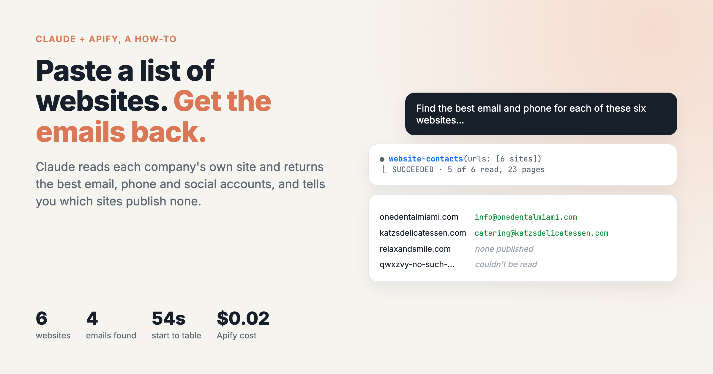
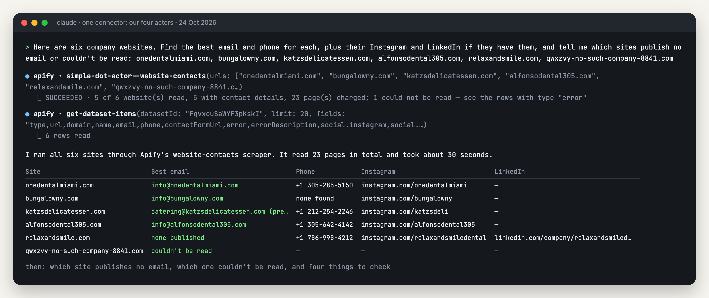

# Paste a list of websites into Claude and get the emails back

*I wrote this with an AI assistant. The runs, numbers and code are real, and I checked them.*



You have a list of company websites (from a spreadsheet, a conference list, an export)
and you want an email and a phone for each. I built [a scraper](https://apify.com/simple.actor/website-contacts) that reads a company's own
site the way a person looking for contact details would: the home page first, then the
contact, about and imprint pages it links to. This guide shows how to run it from
Claude by pasting the list into a chat.

My test list had six sites. Four emails came back, plus one site that publishes none
and one domain that doesn't exist, each labelled for what it was. It took 54 seconds
and cost about two cents.

## Setup

If you followed the [Google Maps leads guide](../google-maps-leads/README.md),
you already have the connector and can skip to the prompt. If not, you need Claude (any
plan; the free one allows one custom connector) and a free Apify account ($5 of usage a
month, no card).

Add this URL as a custom connector. In claude.ai or the desktop app, that's Customize →
Connectors → + Add → Add custom connector, then sign in to Apify. In Claude Code, run
`claude mcp add --transport http lead-tools "<url>"` and then `/mcp`.

```
https://mcp.apify.com/?tools=simple.actor/google-maps-leads,simple.actor/website-contacts,simple.actor/google-ads-transparency,simple.actor/linkedin-jobs
```

It loads four of my actors and nothing else. The one this guide uses is Website
Contacts.

## The prompt

```
Here are six company websites. Find the best email and phone for each, plus their Instagram and LinkedIn if they have them, and tell me which sites publish no email or couldn't be read: onedentalmiami.com, bungalowny.com, katzsdelicatessen.com, alfonsodental305.com, relaxandsmile.com, qwxzvy-no-such-company-8841.com
```

The last sentence matters most. A site that publishes no email and a site that couldn't
be opened at all are different problems. You'd phone the first and fix the address of
the second, so ask Claude to keep them apart. The last domain on my list doesn't exist,
and it's there to show what that looks like.

## What happened



Two tool calls. Claude sent all six sites to Website Contacts in one run (28 seconds, 23
pages read), then read back only the fields it needed. The answer:

| Site | Best email | Phone | Instagram | LinkedIn |
|---|---|---|---|---|
| onedentalmiami.com | info@onedentalmiami.com | +1 305-285-5150 | instagram.com/onedentalmiami | — |
| bungalowny.com | info@bungalowny.com | none found | instagram.com/bungalowny | — |
| katzsdelicatessen.com | catering@katzsdelicatessen.com (press@ also listed) | +1 212-254-2246 | instagram.com/katzsdeli | — |
| alfonsodental305.com | info@alfonsodental305.com | +1 305-642-4142 | instagram.com/alfonsodental305 | — |
| relaxandsmile.com | none published | +1 786-998-4212 | instagram.com/relaxandsmiledental | linkedin.com/company/relaxandsmiledentalcare |
| qwxzvy-no-such-company-8841.com | couldn't be read | — | — | — |

I checked every cell against the raw data afterwards, and they all match.

What I liked is what came after the table. Claude said Relax & Smile publishes no email,
only a contact form on its home page, so use the phone or the form. It said the made-up
domain couldn't be reached at all and probably doesn't exist. Then it flagged four
things a person would want to know:

- Bungalow's site also links to info@gupshupnyc.com, which looks like it belongs to a
  related restaurant, so Claude didn't count it as Bungalow's.
- Alfonso Dental's page data carries an older-looking address, info@alfonsodental.com.
  Claude picked the one on the clickable link, which matches the site's own domain.
- Katz's has two addresses: catering@ as the general one and press@ for media.
- Only one of the five sites it could read links a LinkedIn page. Claude added that the
  others may still have one; their sites just don't link to it.

I found nothing wrong in this answer. One extra fact from my own data: the number on
Relax & Smile's website (786-998-4212) is not the one on its Google Maps listing
(786-983-4812). The scraper reports what the website says. If a number matters, the
listing and the site are both worth a look.

## What it costs

$0.001 a run plus $0.00075 per page read. Most sites in my test took 5 pages (the
default limit), and Bungalow took 3. The dead domain took none and wasn't charged.
Six sites came to $0.018. A list of 100 sites would be roughly $0.35. Claude's own usage
comes out of your Claude plan.

## Longer lists

Paste them in. A column copied out of a spreadsheet works; bare domains without
`https://` are fine. Two things help with a long list:

- **Ask Claude to read back only the columns you want.** It did this by itself here, but
  on a few hundred sites a full read can be too big for one reply, and in Claude Code
  it will page through the results instead.
- **Sites behind a bot check come back as "couldn't be read"**, with the reason. In my
  Google Maps test, 3 of 40 dental sites did that. The scraper doesn't try to get around
  those checks. Those are the ones to phone.

## When to use this rather than the Maps guide

If you start from a place and a type of business ("dentists in Miami"), use the
[Google Maps leads guide](../google-maps-leads/README.md). It finds the
businesses and reads their sites in one go. Use this one when you already have the
companies and only need their contact details.
