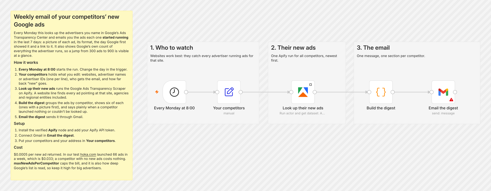
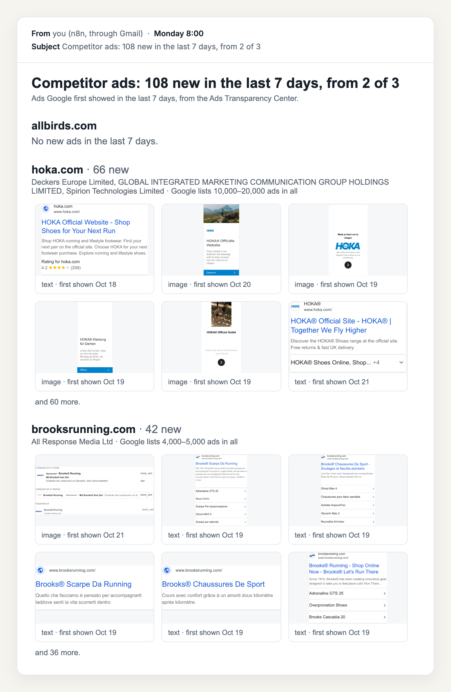

# A weekly email of your competitors' new Google ads

*I wrote this with an AI assistant. The runs, numbers and code are real, and I checked them.*

Every Monday this looks up the sites you compete with in Google's Ads Transparency
Center and emails you the ads each one **started running** that week: a picture of
each, its format, the day Google first showed it, and a link to it. It also shows Google's
count of everything each advertiser runs, so a jump from 300 to 900 is easy to spot.

It uses the [Google Ads Transparency](https://apify.com/simple.actor/google-ads-transparency)
actor on Apify, and Gmail.

## How it works

1. **Every Monday at 8:00** starts it.
2. **Your competitors** holds what you edit: websites, advertiser names or advertiser IDs
   (one per line), who gets the email, and how far back "new" goes (`7 days`).
3. **Look up their new ads** runs the actor. A website line catches every advertiser
   running ads for that site, including regional companies and agencies.
4. **Build the digest** groups the ads by competitor and shows six of each, with
   pictures first. A competitor that launched nothing gets a line saying so, and one that
   couldn't be looked up gets the reason.
5. **Email the digest** sends it through Gmail.

## Set it up

1. Download [`workflow.json`](workflow.json). In n8n: new workflow → **⋯** → **Import
   from File**.
2. Install the Apify node if needed. On n8n Cloud, search "Apify" in the node panel.
   Self-hosted: **Settings → Community Nodes → `@apify/n8n-nodes-apify`**. Add your Apify
   API token as its credential.
3. Connect Gmail in **Email the digest**.
4. Put your competitors and your email address in **Your competitors**.

## A real run

`allbirds.com`, `hoka.com`, `brooksrunning.com`, ads first shown in the last 7 days: 118
seconds, **108 new ads**. That was 66 for hoka.com, 42 for brooksrunning.com, and none for
allbirds.com (the email says so). Here is the email it built:

Google keeps no picture for some ads (75 of these 108). The email shows the ones with a
picture first, and the rest say "no picture kept · open on Google".

An advertiser name that doesn't exist came back as "Couldn't look this one up: No
advertiser named like…", and the other competitors went through normally.

## Why it reads 5,000 ads per competitor

Google lists an advertiser's ads by when they were last shown, and a big advertiser has
thousands of long-running ads above the new ones. `maxNewAdsPerCompetitor` caps how many
come back, and it's also how deep the list is read. In the same test, hoka.com's new ads
for the week numbered 5 when 100 were read, 53 at 1,000, and 66 at 5,000. You only pay for
new ads, so reading deep costs time, not money.

## What it costs

$0.0005 per new ad, so the 108 above cost $0.054. A competitor with nothing new costs
nothing.

## Tested on

n8n 2.44.6 self-hosted, Apify node 0.9.0, 24 Oct 2026. Every step before the Gmail node
ran for real, and the email above is the HTML it produced. The Gmail node is n8n's
own, and it's the one step you connect to your own account.
