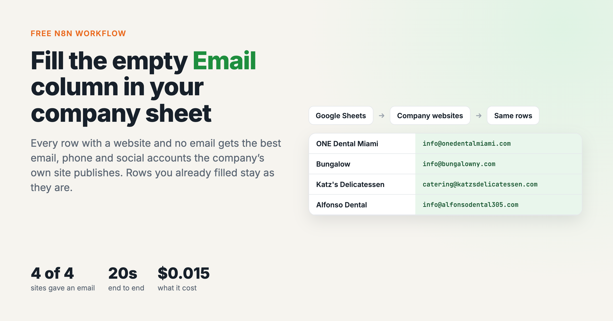
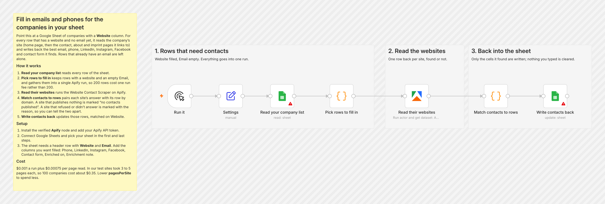
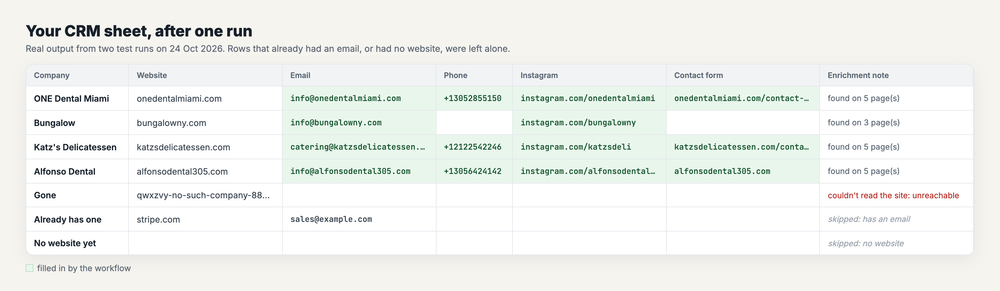

# Fill in emails and phones for the companies in your sheet

*I wrote this with an AI assistant. The runs, numbers and code are real, and I checked them.*

You have a Google Sheet of companies with a **Website** column and a lot of empty
**Email** cells. This reads each company's own website (the home page, then the
contact, about and imprint pages it links to) and writes back the best email, phone,
LinkedIn, Instagram, Facebook and contact-form link it finds. Rows that already have an
email are left alone.

It uses the [Website Contacts](https://apify.com/simple.actor/website-contacts) actor on
Apify.

## How it works

1. **Read your company list** reads every row.
2. **Pick rows to fill in** keeps rows with a website and an empty Email, and sends them
   all to Apify in **one run**. 200 rows cost one run fee, not 200.
3. **Read their websites** runs the actor.
4. **Match contacts to rows** pairs each site's answer with its row by domain. Only cells
   it found are written, so nothing you typed is cleared.
5. **Write contacts back** updates the rows, matched on Website.

A site that publishes no contact details is marked `no contacts published`. A site that
refused the visit or doesn't exist is marked `couldn't read the site: <reason>`. One
means phone them; the other means fix the address.

## Set it up

1. Download [`workflow.json`](workflow.json). In n8n: new workflow → **⋯** → **Import
   from File**.
2. Install the Apify node if needed. On n8n Cloud, search "Apify" in the node panel.
   Self-hosted: **Settings → Community Nodes → `@apify/n8n-nodes-apify`**. Add your Apify
   API token as its credential.
3. Connect Google Sheets and pick your sheet in the first and last steps.
4. Your sheet needs **Website** and **Email** columns. Add the ones you want filled:
   Phone, LinkedIn, Instagram, Facebook, Contact form, Enriched on, Enrichment note.

## A real run

Six rows: four companies with no email, one that already had one, and one with no
website. 20 seconds. **All four sites gave an email**, and the two other rows were
skipped. In a second run I added a domain that doesn't exist, and it was marked
`couldn't read the site: unreachable`, with no other cell touched.

## What it costs

$0.001 a run plus $0.00075 per page read. The sites above took 3 to 5 pages each, so the
four cost $0.015, and 100 companies come to about $0.35. Lower `pagesPerSite` in
**Settings** to spend less.

## Tested on

n8n 2.44.6 self-hosted, Apify node 0.9.0, 24 Oct 2026. In my test, sample rows stood in
for the first Sheets node and the results went to a CSV instead of the last one.
Everything in between, including the single Apify run and the matching, is the workflow
as shipped. The two Sheets nodes are n8n's own, and you connect them to your account.
