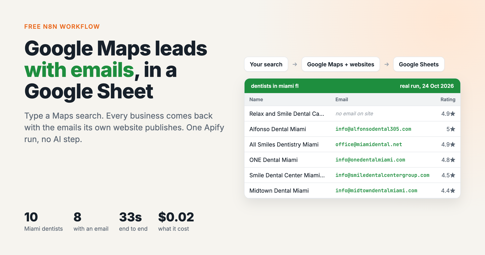
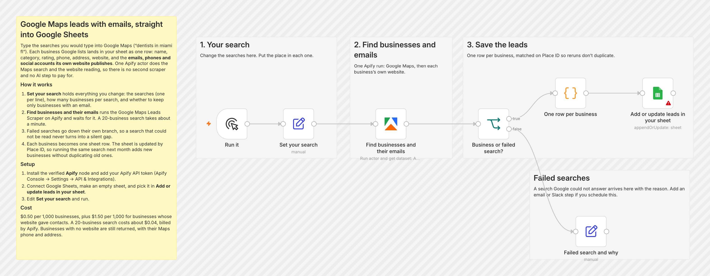
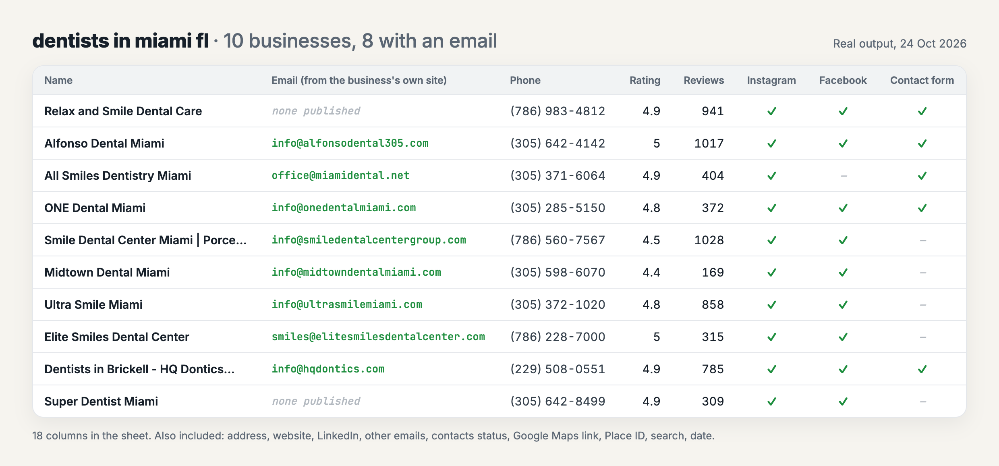

# Google Maps leads with emails → Google Sheets

*I wrote this with an AI assistant. The runs, numbers and code are real, and I checked them.*

You type the searches you'd type into Google Maps ("dentists in miami fl"), and every
business Google lists lands in your sheet as one row: name, category, rating, review
count, phone, address and website, plus the **emails, phones and social accounts its
own website publishes**.

The Maps search and the website reading are one Apify actor,
[Google Maps Leads](https://apify.com/simple.actor/google-maps-leads), so there's no
second scraper to chain and no AI step to pay for.

## How it works

1. **Set your search** holds everything you change: the searches (one per line), how
   many businesses per search, and whether to keep only businesses with an email.
2. **Find businesses and their emails** runs the actor and waits for it. A 20-business
   search takes about a minute.
3. A search Google couldn't answer goes down its own branch with the reason, so it
   never turns into a quiet gap in your sheet.
4. Each business becomes one row, matched on Google's Place ID. Run the same search next
   month and you get the new businesses without duplicates.

## Set it up

1. Download [`workflow.json`](workflow.json). In n8n, open a new workflow, then use the
   **⋯** menu → **Import from File**.
2. Install the Apify node if you don't have it. It's verified by n8n: on n8n Cloud, search
   "Apify" in the node panel and install it. Self-hosted: **Settings → Community Nodes →
   Install → `@apify/n8n-nodes-apify`**.
3. Add your Apify API token as the node's credential (Apify Console → Settings → API &
   Integrations). A free Apify account comes with $5 of usage a month.
4. Connect Google Sheets, make an empty sheet, and pick it in **Add or update leads in
   your sheet**.
5. Edit **Set your search** and run.

## A real run

`dentists in miami fl`, 10 businesses: 33 seconds end to end, **8 of 10 with an email**,
all 10 with a phone and an Instagram account.

A search that's too short to mean anything (I tried `x`) came back down the failure
branch as `"x" is too short to search Google Maps for.` Nothing reached the sheet.

## What it costs

$0.50 per 1,000 businesses, plus $1.50 per 1,000 for each business whose website gave
contacts. A 20-business search is about $0.04. The ten above cost $0.02. A business
whose website gives nothing isn't charged the second part.

## Tested on

n8n 2.44.6 self-hosted, Apify node 0.9.0, 24 Oct 2026. Every step before the Sheets node
ran for real against the live actor. The Sheets node is n8n's own append-or-update,
and it's the one step you connect to your own account.

## Make it yours

- Turn on `onlyBusinessesWithEmail` to keep only rows you can email.
- Swap the manual trigger for a **Schedule Trigger** to check an area every week.
- To get more than Google's ~120–140 per search, split the search by neighbourhood:
  "dentists in brickell miami", "dentists in coral gables".
