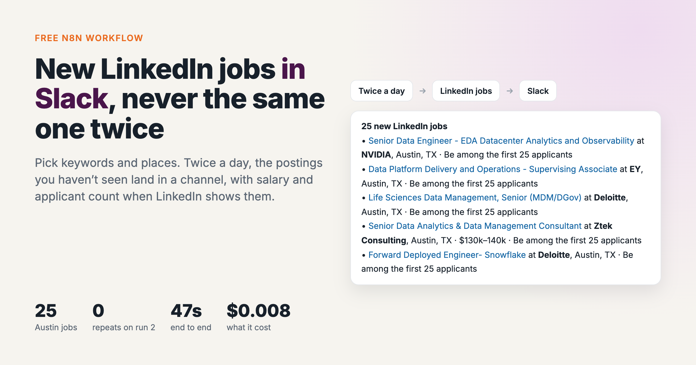
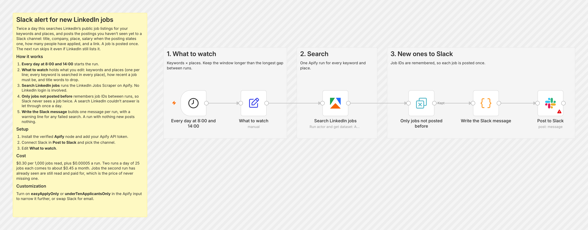
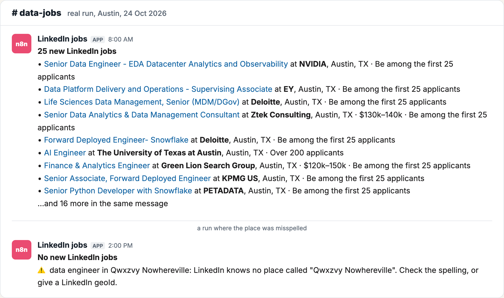

# New LinkedIn jobs → Slack, twice a day

*I wrote this with an AI assistant. The runs, numbers and code are real, and I checked them.*

Twice a day this searches LinkedIn's public job listings for your keywords and places,
and posts the jobs you haven't seen yet to a Slack channel: title and link, company,
place, salary when the posting states one, and how many people have applied. No
LinkedIn login is involved.

It uses the [LinkedIn Jobs](https://apify.com/simple.actor/linkedin-jobs) actor on Apify.
It's useful for recruiters watching a market, for job hunters, and for sales teams who
treat "this company is hiring for X" as a buying signal.

## How it works

1. **Every day at 8:00 and 14:00** starts it.
2. **What to watch** holds the keywords and places (every keyword is searched in every
   place), how recent a job must be (`24 hours`), and title words to drop.
3. **Search LinkedIn jobs** runs the actor.
4. **Only jobs not posted before** remembers job IDs between runs, so each job reaches
   Slack once. A search LinkedIn couldn't answer is let through once a day, so you hear
   about it.
5. **Write the Slack message** builds one message per run. A run with nothing new posts
   nothing.

## Set it up

1. Download [`workflow.json`](workflow.json). In n8n: new workflow → **⋯** → **Import
   from File**.
2. Install the Apify node if needed. On n8n Cloud, search "Apify" in the node panel.
   Self-hosted: **Settings → Community Nodes → `@apify/n8n-nodes-apify`**. Add your Apify
   API token as its credential.
3. Connect Slack in **Post to Slack** and pick a channel.
4. Edit **What to watch**.

## A real run

`data engineer` in `Austin, Texas, United States`: 47 seconds, **25 jobs**. Three of
them stated a salary ($120k–150k, $130k–140k, $145k–175k), and the message shows it.

I ran the same search again a few minutes later. LinkedIn returned the same 25 jobs, the
dedupe step let none through, and nothing would have been posted. Then I misspelled the
place on purpose, and the run posted one line saying LinkedIn knows no place by that
name, instead of looking like a quiet day.

## Why a 24-hour window

The runs are 6 hours apart in the day and 18 overnight. Any window shorter than the
longest gap misses jobs, so the window is 24 hours, and the dedupe step absorbs the
overlap.

## What it costs

$0.30 per 1,000 jobs read, plus $0.00005 a run. Two runs a day of 25 jobs is about $0.45
a month. Jobs the dedupe drops are still read and paid for. That's the price of never
missing one.

## Tested on

n8n 2.44.6 self-hosted, Apify node 0.9.0, 24 Oct 2026, with the window at 12 hours for
the test. Every step before the Slack node ran for real, and the message above is the
text it produced. The Slack node is n8n's own, and it's the one step you connect to your
own account.
